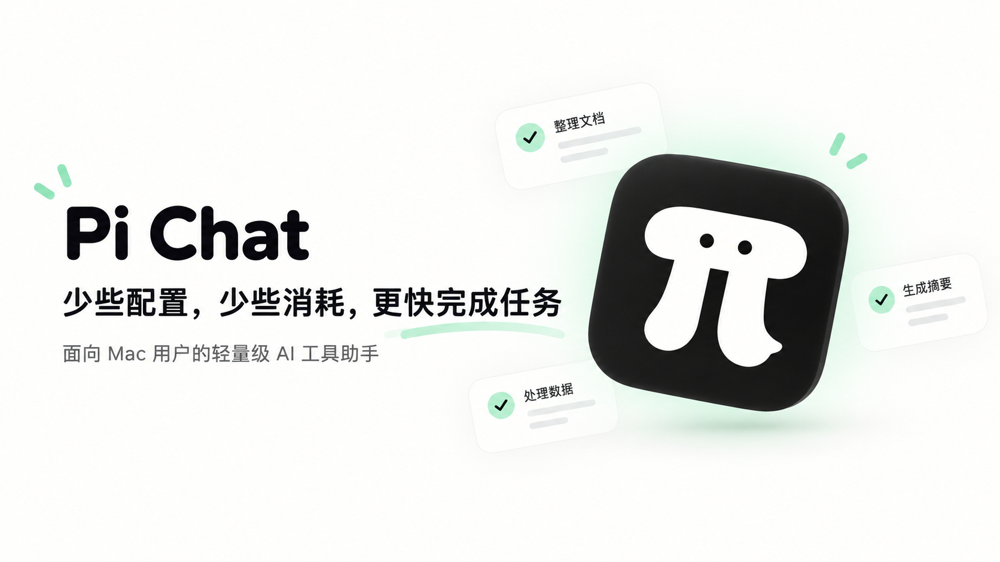
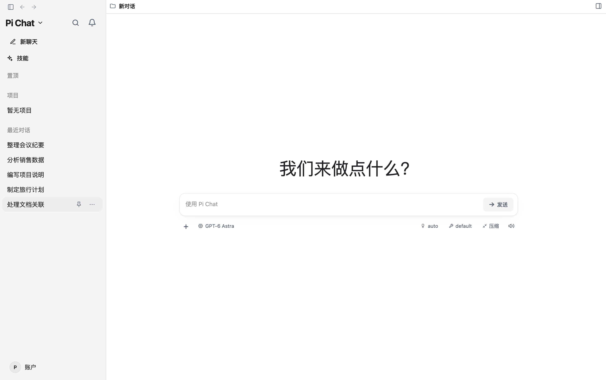
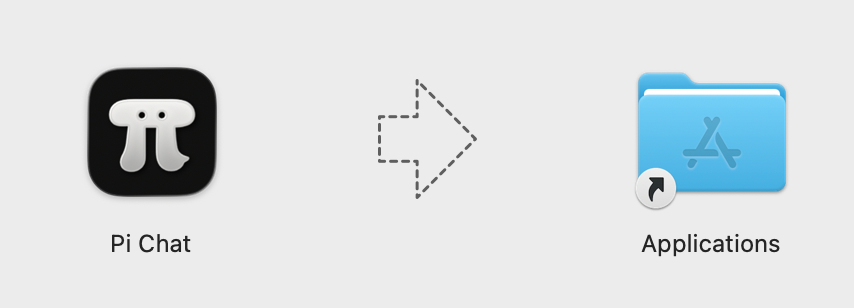
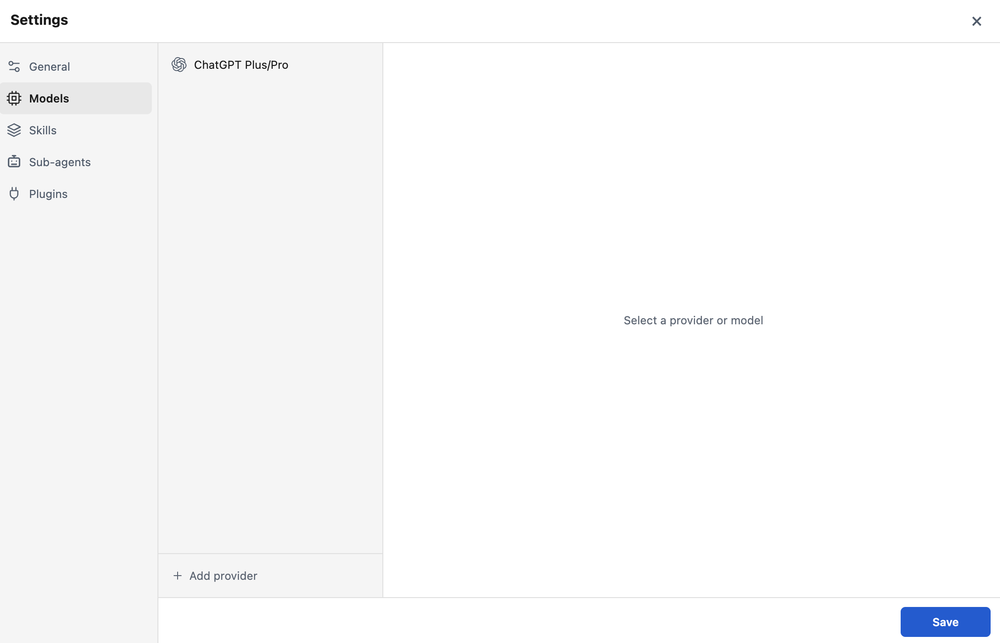

# Pi Chat

[简体中文](./README.md)

[](https://github.com/bsin-ai/pi-chat/actions/workflows/ci.yml)



**A lightweight AI work assistant for Mac users**

Pi Chat puts projects, conversations, files, and Skills in one desktop app. After you configure a model, you can start tasks in natural language like you would in any other Mac app, without learning or operating pi Agent's command-line workflow.

## Table of contents

- [What is Pi Chat](#what-is-pi-chat)
- [What Pi Chat Can Do](#what-pi-chat-can-do)
- [Download and Install](#download-and-install)
- [First Launch](#first-launch)
- [Main Features](#main-features)
- [Privacy and Security](#privacy-and-security)
- [Frequently Asked Questions](#frequently-asked-questions)
- [Current Limitations](#current-limitations)
- [Run from Source](#run-from-source)
- [License](#license)

## What is Pi Chat

Pi Chat is a lightweight AI work assistant for Mac users and a local desktop interface for the [pi coding agent](https://github.com/earendil-works/pi). It puts projects, conversations, files, and Skills in one app, so you can choose your own model provider, API key, and model, then describe a task in everyday language.

Pi Chat does not provide an AI model itself. You connect a model provider of your choice and follow that provider's pricing, quota, and usage rules.

### Core value

Pi Chat is designed to make everyday work more direct in these ways:

- Reduce tool setup so you can start in one desktop app.
- Reduce repeated input and unnecessary context, helping reduce unnecessary token usage.
- Help the model stay focused on the current task and the material you provide.
- Replace complicated command-line operations with a desktop interface.

### Who is it for

- People who want to use an AI assistant on their own Mac without first learning a complex command-line workflow.
- People who need to organize material, process documents, analyze projects, or keep several tasks moving.
- People who want local project and conversation management while connecting different model providers as needed.
- Developers can run and extend Pi Chat from source, but everyday use does not require programming skills.

## What Pi Chat Can Do

Pi Chat is useful for work that involves reading material, organizing information, or making steady progress, such as:

- Organizing and analyzing meeting notes, research material, and other text.
- Reading and processing Word, PDF, Excel, PPT, Markdown, and plain-text files.
- Assisting with code and project tasks, understanding project content, and reviewing changes.
- Previewing source code, Markdown, images, audio, PDF, and DOCX files.
- Viewing Git Diff to understand what changed in a file.
- Managing multiple projects and conversation history, then continuing work by project.
- Continuing an existing conversation or creating a branch to try another direction.



## Download and Install

### 1. Check your Mac chip

The current desktop release mainly supports **Apple Silicon** Macs, including M1, M2, M3, M4, and later models. Intel Macs are not currently supported.

### 2. Download a DMG from GitHub Releases

Open [Pi Chat GitHub Releases](https://github.com/bsin-ai/pi-chat/releases), then click `Pi-Chat-1.1.0-arm64.dmg` in the latest release's **Assets** section to download the Apple Silicon installer. Download only from a trusted GitHub Releases page; if the filename differs, choose the `.dmg` file actually provided by that release.

[Direct download: Pi-Chat-1.1.0-arm64.dmg](https://github.com/bsin-ai/pi-chat/releases/download/v1.1.0/Pi-Chat-1.1.0-arm64.dmg)

### 3. Drag the app to Applications

Open the downloaded DMG, drag **Pi Chat** to the **Applications** folder, and launch Pi Chat from Applications. A normal DMG installation does not require Node.js.



### 4. Handle the macOS security warning on first launch

The current version has not completed Apple Developer signing and notarization. Because macOS checks applications downloaded from the internet, the first launch may show an “unidentified developer” or “app is damaged” warning.

First confirm that the app was downloaded from this project's official [GitHub Releases](https://github.com/bsin-ai/pi-chat/releases) page and dragged to **Applications**. Then open Terminal and run:

```bash
xattr -dr com.apple.quarantine "/Applications/Pi Chat.app"
```

After the command finishes, return to Applications and double-click **Pi Chat** to launch it. This command only removes macOS's quarantine attribute for this app; do not run it for applications from unknown sources.

## First Launch



### 1. Configure a model and API key

Open the **Models** panel, add a Provider, enter an API key, and choose a model. If the provider supports it, you can use its sign-in flow instead. Before sending sensitive or large content, check the provider's pricing, quota, billing, and data-retention rules.

An API key is sensitive information. Keep it private, and never publish it, commit it to a repository, or share it in a screenshot.

### 2. Install commonly used Skills

Skills add capabilities for specific tasks. Install them as needed from the **Skills** panel and choose their scope:

| Skill | Useful for |
| --- | --- |
| `docx` | Reading and processing Word documents |
| `pdf` | Reading and processing PDFs |
| `xlsx` | Working with Excel spreadsheets |
| `pptx` | Reading and editing presentations |
| `markitdown` | Converting material to Markdown |
| `tavily-search` | Searching the web |

You do not need to install every Skill at once. Start with the capability required for the current task and add more for later projects or work. A Skill can apply to all projects or only to the current project.

### 3. Start your first conversation

Create or choose a project, describe your goal in the chat box using natural language, and attach or browse relevant files when needed. When a task changes a file, review the result and the changes in the app before accepting them.

## Main Features

### 1. Start a task directly in natural language

Describe what you want to accomplish. Pi Chat uses the current project and conversation context to help organize, analyze, find, or change content. You do not need to remember commands or internal directories.

### 2. Organize work with projects, titles, and pins

Keep a conversation in the right project, give important tasks a title, and pin them so you can return to work in progress. Projects and conversations can be managed separately, which helps when you work on several topics at once.

### 3. Find conversations by activity or project

Use the sidebar to view recent activity or browse conversation history by project. This makes it easy to return to a task you used recently or to a project's longer-running work.

### 4. Review task progress, results, context, and cost

While a task is running, you can follow its progress and process. After it finishes, you can review the result, context used, cost, and related run information. Pi Chat also supports file previews and Git Diff so you can check the changes the model proposed.

### 5. Navigate long conversations with chat navigation

When a conversation becomes long, chat navigation helps you jump to different messages and stages of the task instead of repeatedly scrolling through the whole page.

### 6. Continue tasks, create branches, and export conversations

Continue an existing conversation, create an independent branch from an earlier message, or try another direction from a point in the current conversation. Export the conversation when you need to keep a record or share it.

### 7. Customize the interface and language

Pi Chat supports English and Simplified Chinese and provides appearance settings. It initially follows your browser language, and you can switch the language and appearance at any time.

## Privacy and Security

- Pi Chat runs on your own Mac. Conversations and some app settings are stored locally by default.
- Reinstalling the app normally does not delete existing conversations. Conversations do not automatically follow you to another Mac, so back them up or migrate them yourself.
- When you use an AI model, your input may be sent to the model provider you choose. Review that provider's privacy policy, data-retention rules, pricing, and quotas first.
- A Skill may call an external service. Before processing sensitive files, confirm which services the Skill uses and whether the files will leave your Mac.
- API keys are sensitive information. Do not publish them, commit them to a repository, or share them in screenshots.
- Pi Chat does not provide an AI model itself. Model fees and service terms are determined by the provider you choose.
- Sharing the Pi Chat app does not automatically share conversations, API keys, or personal settings. Other users need to configure their own model service on their own Mac.

## Frequently Asked Questions

### Do I need to install Node.js?

A normal DMG installation does not require Node.js. Node.js **22.19.0 or newer** is needed only when running from source or contributing to development.

### Do I need programming skills?

Everyday use does not require programming skills. You can describe tasks in natural language; running from source and contributing to development require basic command-line knowledge.

### Is Pi Chat free?

The Pi Chat project uses the MIT License, and the app itself does not charge a usage fee. A model service may require an API key, and model costs are determined by the provider you choose.

### Where are conversations stored?

Conversations are stored on your Mac by default.

### Will reinstalling delete my conversations?

Reinstalling the app normally does not delete existing conversations. Deleting user data, cleaning it up manually, or changing the runtime environment can cause data loss, so back up important conversations first.

### How do I update Pi Chat?

The current version does not support automatic updates. Download a new DMG from [GitHub Releases](https://github.com/bsin-ai/pi-chat/releases) and replace the old app in Applications.

## Current Limitations

- The app currently supports macOS only.
- It mainly supports Apple Silicon and does not currently support Intel Macs.
- Linux is not currently supported.
- There is no App Store version yet.
- The current version has not completed Apple Developer signing and notarization, so macOS may show a security warning on first launch.
- Automatic updates are not currently supported.
- A model service may require an API key and may charge for usage.

## Run from Source

This section is for developers; normal DMG users can skip it. Normal users do not need Node.js. Node.js **22.19.0 or newer** is needed only when running from source or contributing to development.

Check your version first:

```bash
node --version
```

Install and run:

```bash
git clone https://github.com/bsin-ai/pi-chat.git
cd pi-chat
npm ci
npm run build
npm start
```

After starting the app, open [http://127.0.0.1:30141](http://127.0.0.1:30141), then configure your Provider, API key, and model in **Models**.

Development mode:

```bash
npm ci
npm run dev
```

Common checks:

```bash
npm test
node_modules/.bin/tsc --noEmit
npm run lint
```

For advanced environment variables, HTTP proxy settings, remote access and HTTPS, Git worktrees, and extension integration, see [Advanced configuration](./docs/advanced-configuration.md). Contributors can also read [Internationalization](./docs/i18n.md), [Release process](./docs/release.md), [Worktrees in Pi Chat](./docs/worktrees.md), and the Chinese guide [Pi Chat 里的 Worktree](./docs/worktrees.zh-CN.md).

## Project origin and maintenance scope

Pi Chat is a customized local desktop application built on the open-source foundation of Pi Web. While the repository retains the upstream code and Git history, this project focuses on productizing and maintaining the following areas:

- Electron desktop packaging and Apple Silicon macOS releases.
- Integration of local sessions, project management, file preview, model configuration, Skills, and Plugins.
- macOS installation compatibility, release documentation, testing, and ongoing iteration.

The Contributors count shown on this repository includes contributors from the upstream Pi Web Git history. Those contributors belong to the upstream project and do not represent a team of the same size currently maintaining Pi Chat. We thank the upstream project and its contributors for the open-source foundation.

## License

Pi Chat is distributed under the [MIT License](./LICENSE).
